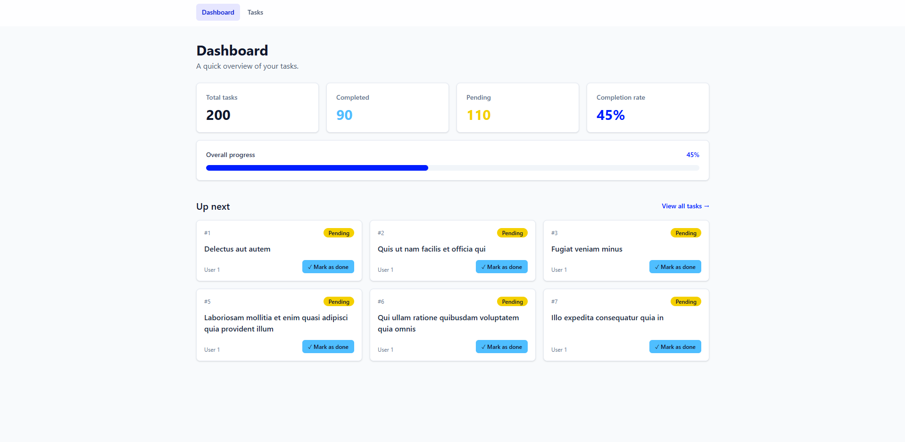
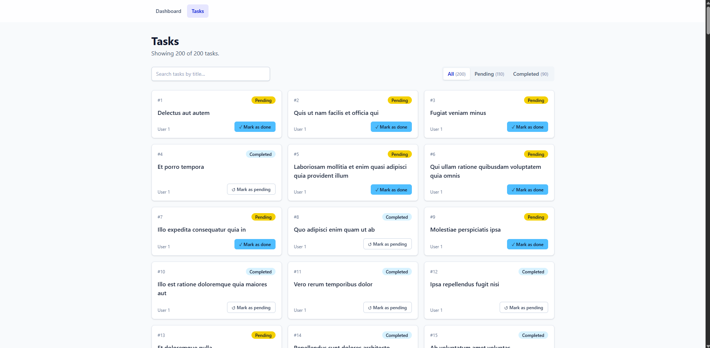
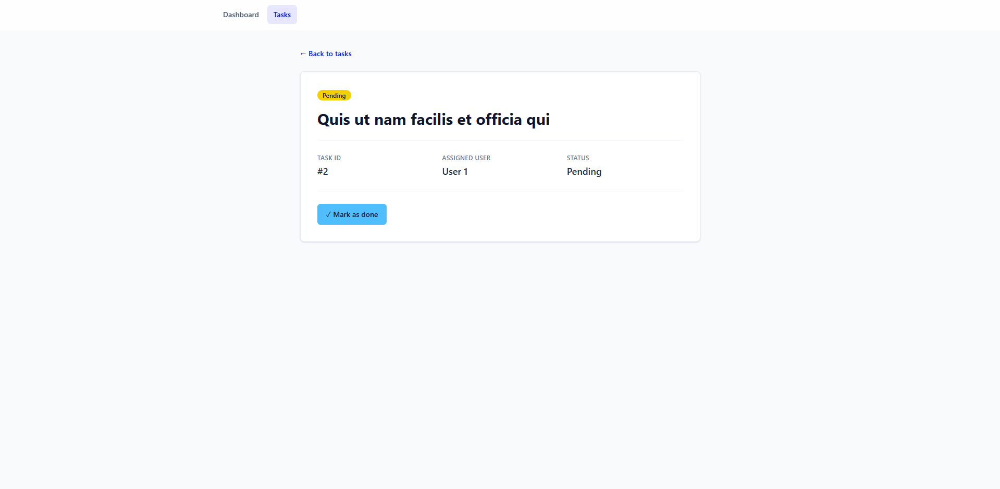
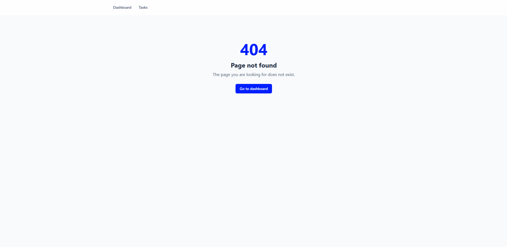
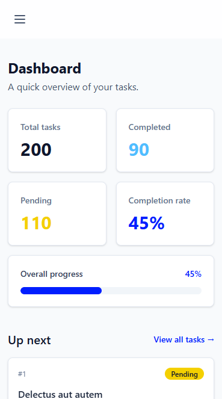
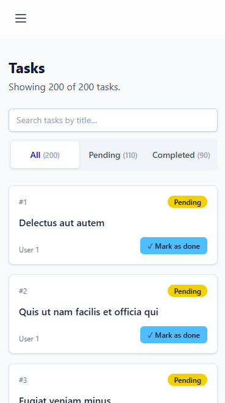
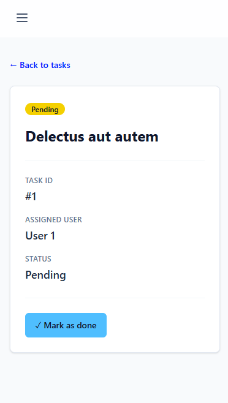
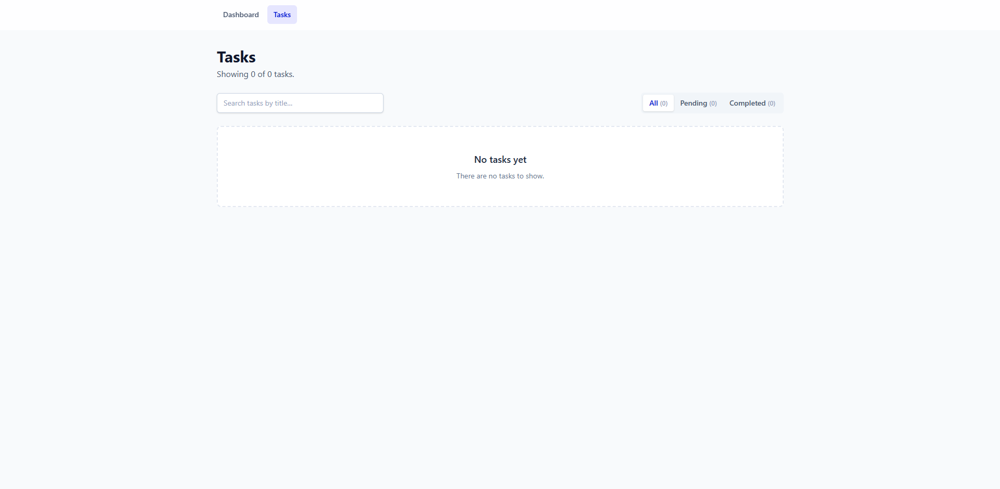
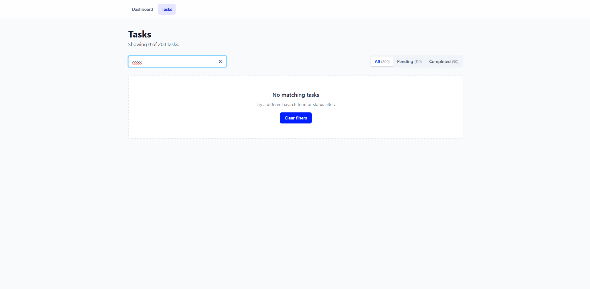

# ToDos

ToDos is a responsive, multi-page task and productivity manager. It shows a dashboard of your progress, a searchable and filterable list of tasks, and a detail page for each task, and lets you mark tasks as done or pending. All data is fetched from a public API using TanStack Query.



## Features

- Dashboard with total, completed and pending counts, completion rate and progress bar
- Task list with title search and an All / Pending / Completed status filter
- Task detail page reached through a dynamic `/tasks/:id` route
- **Mark as done / Mark as pending** button on every task card and on the detail page
- Loading, error, empty and not-found states
- Responsive layout with a hamburger menu on mobile

### Routes

| Route | Page | What it shows |
| --- | --- | --- |
| `/` | Dashboard | Total, completed and pending task counts, completion rate, a progress bar, and the next six pending tasks |
| `/tasks` | Tasks | All tasks as responsive cards, with a title search and an All / Pending / Completed status filter |
| `/tasks/:id` | Task detail | **Dynamic route.** Reads `id` with `useParams()` and fetches and displays the matching task |
| `*` | Not found | A 404 page for any unknown URL |

### Public API

[JSONPlaceholder](https://jsonplaceholder.typicode.com/) `/todos` endpoint:

- `GET https://jsonplaceholder.typicode.com/todos` returns the list of 200 tasks
- `GET https://jsonplaceholder.typicode.com/todos/:id` returns a single task (used by the dynamic route)

Each task has the shape `{ userId, id, title, completed }`. Tasks can be marked done or pending. JSONPlaceholder accepts the update but does not save it, so a page refresh brings back the original statuses.

### TanStack Query

All server data is fetched and cached by TanStack Query. There is no hand-written `useEffect`/`useState` fetching.

- **Query keys** come from a single factory in `src/api/todos.js`:
  - `['todos']` for the task list (`useTodos` hook)
  - `['todos', id]` for a single task (`useTodo` hook), so each task is cached separately
- The Dashboard and Tasks pages share the `['todos']` cache, so the list is fetched once.
- `initialData` seeds a task's detail page from the cached list, so it opens instantly and shows any status you toggled.
- **Marking a task done or pending** uses `useMutation` (`useToggleTodo` hook) to send `PATCH /todos/:id`:
  - `onMutate` updates the `['todos']` and `['todos', id]` caches optimistically, so the card, detail page, filter counts and dashboard stats change at once.
  - `onError` rolls the caches back and the button shows "Could not update".
  - The queries are not invalidated after success, because a refetch from JSONPlaceholder would undo the change.
- Non-OK responses (for example a 404) throw an `HttpError`, so they become TanStack errors. A 404 is not retried.
- Requests are cancelled via the `signal` passed to `fetch` when you navigate away.

### Loading, error and empty states

| State | How it is handled | How to demonstrate it |
| --- | --- | --- |
| **Loading** | `isPending` from `useQuery` shows a spinner (`Loader`) | DevTools → Network → set throttling to **Slow 3G**, then reload `/tasks` or `/tasks/7` |
| **Error** | `error` from `useQuery` shows `ErrorMessage` with a **Try again** button that calls `refetch` | DevTools → Network → **Offline**, then reload `/tasks`. Switch back online and click **Try again**. |
| **Not found** | A 404 from the API shows "Task not found" (no retry) | Visit `/tasks/9999` or `/tasks/abc` |
| **Empty (no tasks)** | `EmptyState` "No tasks yet" when the API returns no tasks. JSONPlaceholder always returns 200, so `?demo=empty` uses TanStack Query's `select` to hand the page an empty list | Visit `/tasks?demo=empty` or `/?demo=empty` |
| **Updating a task** | The toggle button is disabled while its mutation is pending. On failure the change is rolled back and an error is shown | DevTools → Network → **Offline**, then click **Mark as done** on a task |
| **Empty (no matches)** | `EmptyState` when no tasks match the search/filter, with a **Clear filters** button | On `/tasks`, search for `zzzz` |

### State management

- Server state (the tasks and their done/pending status) is owned by TanStack Query. It is never copied into `useState`, so there is one source of truth.
- UI state uses `useState` at the lowest component that needs it:
  - `searchTerm` and `status` live in `TasksPage`, the nearest common parent of the filter controls and the task list.
  - `isMenuOpen` lives in `Navbar`, the only component that uses it.
- The filtered task list and the dashboard stats are derived on each render (`filterTodos`, `getTaskStats`), not stored in separate state.

### Components and data flow

- **Pages** (`src/pages`) fetch data through hooks and decide which state to show (loading, error, empty or content).
- **Presentational components** (`src/components`) receive data through props and report user actions through callbacks. For example, `TasksPage` passes `searchTerm` and `onSearchChange` to `TaskFilters`, which passes them to `SearchInput`.
- **Hooks** (`src/hooks`) wrap TanStack Query, so components never call `fetch` directly.
- `ToggleStatusButton` calls the `useToggleTodo` hook itself, so the task status does not need to be passed down through several components (no prop drilling).

## Screenshots

| Dashboard (`/`) | Tasks with "Pending" filter (`/tasks`) |
| --- | --- |
|  |  |

| Task detail (`/tasks/2`) | Not found (`/does-not-exist`) |
| --- | --- |
|  |  |

**Mobile (390px wide)**

| Dashboard | Tasks | Task detail |
| --- | --- | --- |
|  |  |  |

**Empty states**

| No tasks yet (`/tasks?demo=empty`) | No matching tasks (search `zzzz`) |
| --- | --- |
|  |  |

## Setup

Requires [Node.js](https://nodejs.org/) 20.19+ or 22.12+.

```bash
git clone https://github.com/Raniel-IIFC/ToDos.git
cd ToDos
npm install
npm run dev
```

Then open http://localhost:5173.

### Other scripts

| Command | Description |
| --- | --- |
| `npm run build` | Create a production build in `dist/` |
| `npm run preview` | Serve the production build locally |
| `npm run lint` | Run ESLint (fails on any warning) |

## Project structure

```
src/
├── api/todos.js        # fetch functions, HttpError, query key factory
├── hooks/              # useTodos, useTodo (useQuery), useToggleTodo (useMutation)
├── components/
│   ├── layout/         # Layout, Navbar
│   ├── dashboard/      # StatCard, ProgressBar
│   ├── tasks/          # TaskList, TaskCard, TaskDetail, StatusBadge, ToggleStatusButton,
│   │                   # TaskFilters, SearchInput, StatusFilter
│   └── ui/             # PageHeader, Loader, ErrorMessage, EmptyState
├── pages/              # DashboardPage, TasksPage, TaskDetailPage, NotFoundPage, RouteErrorPage
├── utils/              # filterTodos, taskStats
├── router.jsx          # route definitions
└── main.jsx            # QueryClientProvider + RouterProvider
```

## Tech stack

React, React Router, TanStack Query, Tailwind CSS, Vite, ESLint.

## Live demo (stretch)

_Not deployed yet._ `vercel.json` is included so that deep links such as `/tasks/5` work on Vercel.
